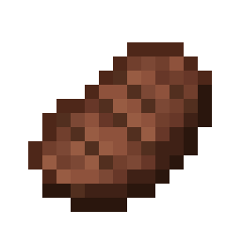
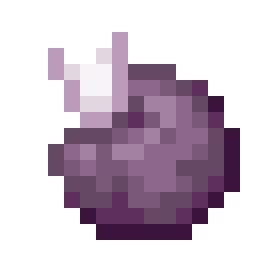

# Minecraft Foods

**把熟悉的 Minecraft 食物装进背包，和朋友一起攀登 PEAK。**

从不同的行李箱里找到苹果、面包和肉类，在营火旁烤一份牛排，或把金苹果留到危险的攀登路段。Minecraft Foods 为 PEAK 加入 **34 种食物**，带来像素风外观、Minecraft 进食音效、独立烹饪规则和各有用途的特殊效果。

食物直接使用 PEAK 的饥饿回复与额外体力数值。同类食品的基础回复经过加强，物品说明会告诉你吃下去能获得什么，以及下一次烹饪会发生什么。

*顶部为宣传插画；下方为随模组提供的物品图标。*

---

## 在攀登途中找到它们

- **不同箱子有不同食物池**：普通行李箱、诅咒行李箱和小丑行李箱各自使用独立的食物权重；复活棺材不生成本模组食物。
- **稀有度决定机会**：日常食材更常见，金苹果和附魔金苹果更难获得。
- **与朋友分享**：可以拾取、携带、丢给队友，也可以使用喂食交互。
- Minecraft 食物默认占普通、诅咒、小丑行李箱掉落位置总权重的 **25%／35%／30%**，房主可分别调整；复活棺材为 **0%**。

### 各类箱子的食物分布

下表比例表示**箱子抽中本模组食物后**，食物在各稀有度档中的分布；它不是每个箱子必出食物的概率。单个食物在档内再按其稀有度权重抽取。

| 箱子 | Minecraft 食物掉落权重占比 | 常见 | 少见 | 稀有 | 特殊 |
| --- | ---: | ---: | ---: | ---: | ---: |
| 普通行李箱 | 25% | 60% | 25% | 12% | 3% |
| 诅咒行李箱 | 35% | 35% | 25% | 30% | 10% |
| 小丑行李箱 | 30% | 45% | 30% | 18% | 7% |
| 复活棺材 | 0% | — | — | — | — |

常见食品包括苹果、面包和肉类；少见食品包括蛋糕、南瓜派和谜之炖菜；稀有食品包括河豚、蜘蛛眼和金胡萝卜；特殊食品包括紫颂果、金苹果和附魔金苹果。诅咒行李箱中腐肉会按少见档分配，提升它在该箱中的出现机会。

## 熟悉的食物，适合 PEAK 的补给

| 日常补给 | 营火料理 | 稀有食物 |
| --- | --- | --- |
|  |  |  |
| 苹果、面包、饼干、胡萝卜和浆果 | 肉类、鱼类、烤马铃薯和各类汤食 | 金苹果、紫颂果和迷之炖菜 |

轻便零食适合途中补充，汤类和大餐适合消耗较大时使用。所有数值直接以 PEAK 的“移除饥饿”和“获得额外体力”显示。

| 食物例子 | 移除饥饿 | 额外体力 |
| --- | ---: | ---: |
| 饼干 | 12 点 | 12 点 |
| 苹果 | 18 点 | 12 点 |
| 面包 | 18 点 | 23 点 |
| 牛排（生牛肉烹饪一次） | 36 点 | 33 点 |
| 蘑菇煲 | 45 点 | 45 点 |
| 兔肉煲 | 48 点 | 46 点 |

数值为未烧焦时的单次食用效果；状态和额外体力仍受游戏自身上限限制。

## 把生肉烤熟，别把晚餐烧毁

- **原槽位变熟**：生肉和生鱼首次烹饪后更换名称与贴图，物品栏图标同步更新，不会为了转换熟食而掉到地上。
- **首次加热提高回复**：其他食物也能从第一次加热中受益，重复加热不会无限叠加收益。
- **每种食物耐热程度不同**：继续加热会逐渐变色，超过各自阈值后烧焦、降低回复并增加中毒，最终烧毁。
- **提前看结果**：拿起食物即可查看当前效果、已烹饪次数和下一次烹饪后的变化。

## 特殊食物，有收益也有代价

| 金苹果 | 紫颂果 | 河豚 |
| --- | --- | --- |
|  |  |  |
| 在危险路段争取喘息时间 | 随机寻找附近安全落脚点 | 食用会中毒，加热也不会让它安全 |

- **金苹果**：获得 5 秒无敌、持续恢复受伤和吸收盾；无敌结束后倒地失控 3 秒。
- **附魔金苹果**：获得 12 秒无敌、更强恢复和吸收盾，附带短时减伤与炎热防护；无敌结束后倒地失控 6 秒。
- **紫颂果**：尝试传送到水平 30 米内的安全落脚点，没有合适位置时留在原地。
- **蜂蜜**：清除中毒与相关持续中毒效果；**牛奶**清除临时效果、中毒和嗜睡，也会移除正面效果。
- **迷之炖菜**：随机获得一种正面或负面效果。
- **河豚、腐肉、蜘蛛眼和毒马铃薯**：保留各自风险；烹饪会继续增加毒性。生肉和生鱼也可能带来生食风险。

## 听得到，也看得懂

食用时播放随包提供的 Minecraft 进食音效，取消或完成时停止。声音通过 SoundAPI 处理，只匹配本模组的进食声音。

物品说明按 PEAK 的表达方式显示回复量、中毒、概率、持续时间、重量和烹饪预览。可搭配 **物品信息显示增强版** 使用；没有它，本模组也能显示说明。

---

## 安装

推荐使用 **r2modman** 或 **Thunderstore Mod Manager** 安装，清单中的前置依赖由管理器处理。

手动安装：

1. 安装下方列出的必要前置。
2. 解压安装包，把其中 `plugins/MinecraftFoods` 整个文件夹复制到 `PEAK/BepInEx/plugins/`。食物与进食音效都在同一个文件夹内。
3. 启动 PEAK，首次运行会生成 `BepInEx/config/codex.peak.minecraftfoods.cfg`。

## 前置与兼容性

必要前置：

- [BepInExPack_PEAK 5.4.2403](https://thunderstore.io/c/peak/p/BepInEx/BepInExPack_PEAK/)
- [PEAKLib Core 1.7.2](https://thunderstore.io/c/peak/p/PEAKModding/PEAKLib_Core/)
- [PEAKLib Items 1.6.2](https://thunderstore.io/c/peak/p/PEAKModding/PEAKLib_Items/)
- [MonoDetour_BepInEx_5 0.6.7](https://thunderstore.io/c/peak/p/MonoDetour/MonoDetour_BepInEx_5/)
- [loaforcsSoundAPI 2.0.13](https://thunderstore.io/c/peak/p/loaforc/loaforcsSoundAPI/)

可选：**物品信息显示增强版（ItemInfoDisplayForkedCNPlus 1.1.3）**，已按该版本显示接口适配，不是启动前置。

- 房主与加入者应安装相同版本及依赖。
- 模组独立运行，不依赖作者其他自定义物品模组。
- 更新时覆盖旧版同名文件夹，不要同时保留多份 Minecraft Foods 插件 DLL。
- 本模组食品的内置说明目前为简体中文。

## 常见问题

**需要 Minecraft 专属箱子吗？**

不需要专属箱子。普通、诅咒和小丑行李箱都有各自的掉落分布；复活棺材不会生成本模组食物。掉落按物品池权重随机抽取，并非每个箱子都有。

**可以修改掉落概率吗？**

可以在房主配置文件的 `[Loot]` 区域分别调整 `MinecraftShare`（普通箱子，默认 `0.25`）、`CursedLuggageMinecraftShare`（诅咒箱，默认 `0.35`）和 `ClownLuggageMinecraftShare`（小丑箱，默认 `0.30`）。修改后重启生效。

**河豚能烤熟解毒吗？**

不能。有毒食物保留风险，过度烹饪会更危险。

**为什么吃金苹果后会倒地？**

这是无敌结束后的代价。可以通过 `Effects.GoldenAppleAftereffects` 配置关闭。

**怎样反馈问题？**

到 [GitHub Issues](https://github.com/Kaitouhan/Peak-MinecraftFood/issues) 提交问题，附上游戏版本、模组版本、复现步骤和相关 `BepInEx/LogOutput.log` 日志。

## 1.25.0 更新

- 对照同类原版食物加强基础回复，首次加热也有收益。
- 改用 PEAK 单位展示食物效果和下一次烹饪结果。
- 调整进食音效播放时机，并适配 SoundAPI 2.0.13。
- 金苹果无敌结束后分别倒地失控 3 秒／6 秒。

本版已完成编译、数值和打包检查；新版的实际听感、显示排版及多人表现仍需游戏内验证。

## 致谢

- PEAK：Aggro Crab 与 Landfall。
- Minecraft 及相关原版资源：Mojang Studios / Microsoft。
- 声音支持：loaforc — loaforcsSoundAPI；物品注册支持：PEAKLib。
- 本项目是非官方社区模组，与上述游戏开发商无隶属关系。源码许可不改变第三方素材的权利归属。

## 链接

- [GitHub 源码](https://github.com/Kaitouhan/Peak-MinecraftFood)
- [问题反馈与建议](https://github.com/Kaitouhan/Peak-MinecraftFood/issues)
